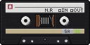

<h1 align="center">Cassette Canvas</h1>

<p align="center">
  
  <br>
  <a href="https://github.com/ChrisAraneo/cassette-canvas/blob/master/package.json"></a>
  <a href="https://github.com/ChrisAraneo/cassette-canvas/blob/master/LICENSE"></a>
  <a href="https://github.com/ChrisAraneo/cassette-canvas/actions/workflows/ci.yml"></a>
  <br>
  <br>
  <em>Retro rendering engine for the HTML canvas.</em>
  <br>
  <br>
</p>

- Sprites use 16 colors with 8 shades each (128 colors).
- Pixels are large, and every sprite has the same size.
- Ambient light and point lights use a scale of 32 shades per color. Sprites can cast shadows.
- Retro monitor effect is always on: a soft glow around bright pixels, scanlines, film grain and a surface texture.

## Installation

```sh
npm install @chris.araneo/cassette-canvas
```

The package is an ES module with TypeScript types included. It runs in the
browser and needs WebGL.

## Concepts

| Concept            | Meaning                                                                                                                                                                                   |
| ------------------ | ----------------------------------------------------------------------------------------------------------------------------------------------------------------------------------------- |
| **Base colors**    | The 16 colors you provide, as `#rrggbb`.                                                                                                                                                  |
| **Shade**          | Sprites can use 8 shades of each color (0 to 7). Shade 4 (`BASE_SHADE`) is the base color. Shades 0 to 3 are darker and 5 to 7 are lighter.                                               |
| **Extended shade** | Lighting uses 32 shades of each color (0 to 31). 4 extended shades = 1 shade. The palette holds all 16 × 32 = 512 colors.                                                                 |
| **Pixel**          | A number with the color in the high hex digit and the shade in the low hex digit. `0x35` is color 3, shade 5. `TRANSPARENT` (`-1`) draws nothing.                                         |
| **Pixel size**     | The size of one logical pixel in canvas pixels, for example `4`. The screen size in logical pixels is the canvas size divided by the pixel size.                                          |
| **Sprite**         | A flat array of `spriteSize × spriteSize` pixels, row by row from the top left.                                                                                                           |
| **Screen**         | Immutable data: the background, sprites, lights and ambient light. Later sprites are drawn over earlier ones.                                                                             |
| **Display**        | The canvas, its WebGL context, the monitor shader and the palette. You create it once.                                                                                                    |
| **Ambient light**  | Shifts every pixel by a number of extended shades. `0` keeps the authored colors. `-16` (4 shades darker) looks like night.                                                               |
| **Light**          | A point at `row`, `column`. At its center it lifts a pixel that daylight already lights by `intensity` extended shades, fading to nothing at `radius`.                                    |
| **Stop**           | One doubling of light, worth `EXTENDED_SHADES_PER_STOP` (4) extended shades. Lights are added as light and then read off this scale, the way the eye does.                                |
| **Shadow**         | A sprite with `castsShadow: true` blocks light. Pixels behind it get no light from that light, and the shadow's edge ramps rather than steps. Its side that faces the light is still lit. |
| **Monitor effect** | A shader that adds a 2-pixel glow, scanlines, film grain and a surface texture. It uses full RGB color, not the palette.                                                                  |

## Usage

```ts
import {
  addLight,
  addSprite,
  createScreen,
  drawScreen,
  patchAmbient,
  patchLight,
  patchLightByOffset,
  patchSprite,
  patchSpriteByOffset,
  toPixel,
  toSprite,
  tryCreateDisplay,
} from '@chris.araneo/cassette-canvas';
import { constant, noop, times } from 'lodash-es';
import { pipe } from 'remeda';
import { match, P } from 'ts-pattern';

const display = tryCreateDisplay(canvas, {
  colors: [
    '#7f7f7f',
    '#d23c3c',
    '#e07a2e',
    '#e6c23a',
    '#98c93c',
    '#3d9e4a',
    '#2e9c8f',
    '#3bb4d6',
    '#4a8fe0',
    '#3c56c8',
    '#5b42c2',
    '#8a45c8',
    '#c045b4',
    '#e0608f',
    '#8c5a36',
    '#d4a373',
  ],
  pixelSize: 4,
  spriteSize: 8,
});

const HEART = toSprite(
  [
    '........',
    '.rr..rr.',
    'rRRrrrrr',
    'rRrrrrrr',
    '.rrrrrr.',
    '..rrrr..',
    '...rr...',
    '........',
  ],
  { r: toPixel(1, 4), R: toPixel(1, 6) },
);

const screen = addSprite(createScreen(toPixel(10, 0)), 'heart', HEART, 20, 30);
const moved = patchSpriteByOffset(screen, 'heart', 0, 5); // 5 pixels right
const placed = patchSprite(moved, 'heart', { row: 40, column: 60 });
```

Draw the screen once per animation frame. Pass the time in milliseconds; it
animates the film grain. `display` can be `undefined`, so check it first:

```ts
const { nonNullable } = P;

requestAnimationFrame((time) =>
  match(display)
    .with(nonNullable, (ready) => drawScreen(ready, placed, time))
    .otherwise(noop),
);
```

`tryCreateDisplay` returns `undefined` if:

- the canvas has no WebGL context,
- the monitor shader cannot be set up,
- `pixelSize` or `spriteSize` is not a positive whole number,
- the canvas is smaller than one logical pixel.

See [`apps/demo/src/main.ts`](https://github.com/ChrisAraneo/cassette-canvas/blob/master/apps/demo/src/main.ts)
for a full animation loop.

### Lights and shadows

Sprites use 8 shades per color. Lighting uses 32 extended shades per color
(`EXTENDED_SHADE_COUNT`). Shade `s` is extended shade `4 × s + 1`. Extended
shade 0 is darker than shade 0, and extended shades 30 and 31 are lighter than
shade 7. Only light can reach them.

```
extended  0  1  2  3  4  5 … 17 … 29 30 31
shade        0           1    4    7
             ↑ darkest            ↑ lightest a sprite can use
```

Light never changes a pixel's color, only its shade. Ambient light and light
intensities are written in extended shades
(`EXTENDED_SHADES_PER_SHADE` = 4 per shade), because that is what you see on
screen. With ambient 0 and no lights, every pixel shows its authored color.

**Lights add up as light, not as shade numbers.** Shade numbers are a
brightness scale, and brightness scales do not add: a room with two lamps is
not twice as bright to look at as a room with one. So the engine turns the
ambient light and each light back into the amount of light behind it, adds
those amounts, and reads the shade off the total. Every doubling of light is
worth the same step on the scale, `EXTENDED_SHADES_PER_STOP` = 4 extended
shades, which is how the eye reads brightness.

What that gives you:

- One light on an unlit scene moves a pixel by exactly its `intensity`, as it
  always did.
- A second light of the same intensity on the same spot adds one step, not
  another full intensity. Ten lamps add a little over three steps.
- A lamp in daylight hardly tells, and the same lamp at night carries the
  whole scene. Nothing piles up into flat white, so sprites and tiles keep
  their shading however many lights reach them.

An `intensity` is therefore best read as _how many extended shades this light
lifts a pixel that daylight already lights_. A lamp that is only there to
light the night wants a small number, around 4 to 6; a flash or an explosion
wants a large one. Ambient and intensity can be fractions; the total is
rounded for each pixel and kept between extended shade 0 and 31.

A light also thins out with distance the way light does in the world, so it
leaves a bright core and a long dim halo rather than a flat disc, and the rim
at `radius` fades out smoothly instead of ending in a visible circle.

Shadow edges are soft. Every shadow carries a penumbra: its edge ramps from
full light to full shadow over two pixels, the way an edge looks under a
light that is not a single point. Only the edge softens, so the heart of a
shadow stays as dark as it ever was and a shadow never fades out as it
lengthens. `SHADOW_SOFTNESS` in `libs/engine/src/lighting/consts.ts` sets how
far the ramp goes, and `0` brings back the hard edges of a point source.

```ts
const WALL = toSprite(times(8, constant('..oooo..')), { o: toPixel(0, 3) });

const night = pipe(
  createScreen(toPixel(8, 5), -16), // light-blue sky, 4 shades darker
  (screen) => addSprite(screen, 'wall', WALL, 40, 60),
  (screen) => patchSprite(screen, 'wall', { castsShadow: true }),
  (screen) =>
    addLight(screen, 'torch', {
      row: 44,
      column: 30,
      radius: 40,
      intensity: 5,
    }),
);

const torchMoved = patchLightByOffset(night, 'torch', 0, 2);
const flickered = patchLight(torchMoved, 'torch', { intensity: 4 });
const dawn = patchAmbient(flickered, -3);
```

With ambient `-16` (night), that torch of intensity `5` lifts its core about
18 extended shades above the night around it, a little past the authored
colors, and fades back to night through many small steps. The same torch at
noon lifts a pixel by 5. Flickering it down to `4` costs about 2 shades at
the core, not 1, because near the center the light is strong and the eye
notices less of it. A big number such as `16` is a flash or an explosion: it
burns the core out to the lightest shade.

A lit frame holds extended pixels:
`toExtendedPixel(color, extendedShade)` = `color × 32 + extendedShade`. The
palette is keyed by extended pixels. `toLitPixel(pixel, shadeOffset)` returns
the extended pixel that a sprite pixel shows under that much light.
`toLitPixel(pixel, 0)` returns its authored color.

### API

| Function                                                            | What it does                                                          |
| ------------------------------------------------------------------- | --------------------------------------------------------------------- |
| `tryCreateDisplay(canvas, { colors, pixelSize, spriteSize })`       | Creates a display, or returns `undefined`                             |
| `drawScreen(display, screen, time)`                                 | Draws the screen with the monitor effect and returns the display      |
| `createScreen(background?, ambient?)`                               | Creates an empty screen (transparent, ambient `0` by default)         |
| `addSprite(screen, id, sprite, row, column)`                        | Adds a sprite on top, replacing any sprite with the same id           |
| `patchSprite(screen, id, { sprite?, row?, column?, castsShadow? })` | Changes a sprite's image (animation), position or shadow              |
| `patchSpriteByOffset(screen, id, rowOffset, columnOffset)`          | Moves a sprite by an offset                                           |
| `removeSprite(screen, id)`                                          | Removes a sprite                                                      |
| `findSprite(screen, id)`                                            | Returns a sprite, or `undefined`                                      |
| `addLight(screen, id, { row, column, radius, intensity })`          | Adds a light, replacing any light with the same id                    |
| `patchLight(screen, id, { row?, column?, radius?, intensity? })`    | Changes a light                                                       |
| `patchLightByOffset(screen, id, rowOffset, columnOffset)`           | Moves a light by an offset                                            |
| `removeLight(screen, id)`                                           | Removes a light                                                       |
| `findLight(screen, id)`                                             | Returns a light, or `undefined`                                       |
| `patchAmbient(screen, ambient)`                                     | Sets the ambient light                                                |
| `toSprite(rows, legend)`                                            | Builds a sprite from text art                                         |
| `toPixel(color, shade)`                                             | Returns a pixel value                                                 |
| `isPixel(value)`                                                    | Checks whether a value is a pixel                                     |
| `toExtendedPixel(color, extendedShade)`                             | Returns an extended pixel                                             |
| `toLitPixel(pixel, shadeOffset)`                                    | Returns the extended pixel a pixel shows under light                  |
| `createPalette(colors)`                                             | Returns the 512 palette colors, keyed by extended pixel               |
| `computeFrame(screen, spriteSize, width, height)`                   | Returns the lit frame as extended pixels, without drawing (for tests) |

Screen functions never change the screen you pass in. They return a new one.

## How drawing works

`drawScreen` runs three steps:

```
screen
  → computeFrame   draw the sprites, then apply light and shadows
  → toFrameBytes   turn extended pixels into RGBA bytes
  → drawCrt        upload the bytes as a texture and draw it with the shader
```

**`computeFrame`** fills the frame with the background and draws each sprite
in order. It also records which pixels belong to sprites that cast shadows.
Then it works out how much light reaches every pixel and moves the pixel to
the matching extended shade.

**Light.** Each light is turned into the amount of light it adds to every
pixel it reaches. Those amounts are added to the ambient light, pixel by
pixel, and the shade comes off the total at 4 extended shades per doubling.
Pixels no light reaches skip that step and keep the ambient light exactly.

**Shadows.** For each light, the engine visits pixels in rings, moving
outward from the light. A pixel gets light if the next pixel toward the light
gets light and does not cast a shadow. This costs one lookup per pixel
instead of tracing a full line back to the light. For the penumbra, a pixel
takes a quarter of its light from each side of that pixel, along the ring it
sits on, which softens the edge of a shadow without touching what the shadow
covers.

**The shader** runs once for every canvas pixel. It:

1. reads the logical pixel under it;
2. adds glow where a pixel within 2 canvas pixels is brighter (flat areas do
   not change);
3. darkens the bottom of each pixel row (scanline);
4. adds film grain, which changes 24 times per second, and a fixed surface
   texture.

The strength of each effect is a constant in `libs/engine/src/crt/consts.ts`.

Everything before the WebGL calls is pure and unit-tested. The WebGL calls are
the only side effects. Each one runs through `runEffect` in `drawCrt`.

## Project layout

```
libs/
├── common/src/        helpers for any lib (runEffect)
└── engine/src/
    ├── index.ts       the public API
    ├── palette/       colors, shades and pixel values
    ├── screen/        sprites, lights and ambient light
    ├── lighting/      light amounts, the shade scale and shadows
    ├── frame/         turns a screen into lit pixels
    ├── crt/           the WebGL monitor shader
    └── display/       draws to the canvas
apps/
└── demo/src/
    ├── main.ts        the animation loop for both canvases
    ├── art/           text art: sky, buildings, street, people, cars, font
    ├── tiles/         cuts large art into sprites and places it
    ├── day/           the time of day and how dark it is
    ├── street/        the city street, composed from scratch every frame
    ├── hud/           the palette swatches, the frame rate and the clock
    └── fps/           measures the frame rate
```

## Demo

Run `npm run dev` and open the page Vite prints. The demo draws two canvases,
each with its own display:

- **The street.** A city street with houses, trees, street lamps, people,
  cars, clouds and a distant skyline. A day and night pass every 48 seconds.
  The ambient light darkens at dusk, and the sun and then the moon cross the
  sky behind the buildings. At night the stars come out, the lamps and
  headlights light up, and people and cars cast shadows. Windows light up one
  by one and go dark again later in the night.
- **The HUD.** A swatch for each of the 128 sprite colors (16 colors × 8
  shades), the frame rate, and the time of day on the street. It has no
  ambient light, so the swatches always show their exact colors, even when it
  is night on the street.

The street does not keep sprites from one frame to the next. Every frame,
`composeStreetScreen` builds a new screen for that moment from the scenery
that never moves (built once) and from everything that does.

## Performance

Measured on the demo street at 1280×720 (320×180 logical pixels), in a
Rolldown bundle run with Node 24. By day the street has 856 sprites and 1
light; at night it has 1,013 sprites and 11 lights:

| Step           | By day  | At night |
| -------------- | ------- | -------- |
| `computeFrame` | ~2.1 ms | ~4.8 ms  |
| `toFrameBytes` | ~0.4 ms | ~0.4 ms  |

Adding up light rather than shade numbers, and softening the shadow edges,
costs nothing by day and about 0.1 ms a frame at night, where 11 lights reach
44% of the screen.

## License

This project is licensed under the MIT License - see the [LICENSE](LICENSE) file for details.

## Author

Krzysztof Pająk (Chris Araneo) - chris.araneo@gmail.com
