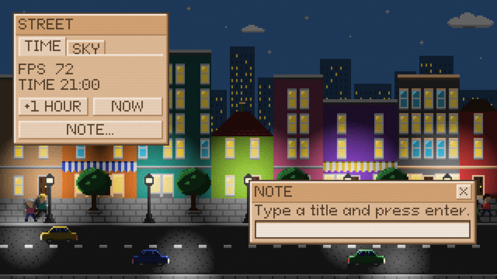

<h1 align="center">Cassette Canvas</h1>

<p align="center">
  
  <br>
  <a href="https://github.com/ChrisAraneo/cassette-canvas/blob/master/package.json"></a>
  <a href="https://github.com/ChrisAraneo/cassette-canvas/blob/master/LICENSE"></a>
  <a href="https://github.com/ChrisAraneo/cassette-canvas/actions/workflows/ci.yml"></a>
  <br>
  <br>
  <em>Retro rendering engine for the HTML canvas.</em>
  <br>
  <br>
</p>

- Sprites use 16 colors with 8 shades each (128 colors).
- Pixels are large, and every sprite has the same size.
- Ambient light and point lights. Sprites can cast shadows.
- Text, windows, buttons, text fields, tabs, panels, dividers, and scrolling
  lists are built in. A list item holds more than one line and widgets of its
  own, and its scroll bar drags.
- Retro monitor effect: a soft glow around bright pixels, scanlines, film grain, and a surface texture.

Full documentation is in [docs/](docs/README.md). The published package ships
it as well, so after an install the same pages are in
`node_modules/@chris.araneo/cassette-canvas/docs`, next to `dist/lib`.

The repository holds an example app in [`apps/demo`](apps/demo): a city street
with a day and night cycle, street lamps, shadows, and a HUD of movable windows
over it. Clone the repository, run `npm install` and `npm run dev`, and open
the page Vite prints. [Demo](docs/DEMO.md) describes what it shows, and
[`apps/demo/src/main.ts`](apps/demo/src/main.ts) is a full animation loop to
read.

## Installation

```sh
npm install @chris.araneo/cassette-canvas
```

The package is an ES module with TypeScript types included. It runs in the
browser and needs WebGL.

## Quick example

```ts
import {
  addHud,
  addHudWindow,
  addLight,
  addSprite,
  createHud,
  createScreen,
  DEFAULT_HUD_COLOR,
  type Display,
  drawScreen,
  handleHud,
  patchSprite,
  TEXT_BOLT,
  TEXT_HEART,
  toPixel,
  toSprite,
  tryCreateDisplay,
} from '@chris.araneo/cassette-canvas';

const PIXEL_SIZE = 4;

// 16 base colors, 4 canvas pixels to a logical pixel, 8 by 8 sprites, and at
// most 60 frames a second.
const display = tryCreateDisplay(canvas, {
  colors: [
    '#7f7f7f',
    '#d23c3c',
    '#e07a2e',
    '#e6c23a',
    '#98c93c',
    '#3d9e4a',
    '#2e9c8f',
    '#3bb4d6',
    '#4a8fe0',
    '#3c56c8',
    '#5b42c2',
    '#8a45c8',
    '#c045b4',
    '#e0608f',
    '#8c5a36',
    '#d4a373',
  ],
  pixelSize: PIXEL_SIZE,
  spriteSize: 8,
  fps: 60,
});

const HEART = toSprite(
  [
    '........',
    '.rr..rr.',
    'rRRrrrrr',
    'rRrrrrrr',
    '.rrrrrr.',
    '..rrrr..',
    '...rr...',
    '........',
  ],
  { r: toPixel(1, 4), R: toPixel(1, 6) },
);

// An indigo night, a heart that casts a shadow, and a torch beside it.
const night = createScreen(toPixel(10, 0), -16);
const placed = addSprite(night, 'heart', HEART, 40, 60);
const caster = patchSprite(placed, 'heart', { castsShadow: true });
const screen = addLight(caster, 'torch', {
  row: 44,
  column: 30,
  radius: 40,
  intensity: 5,
});

// A window over the scene, with a line of text, a button under it, and a
// list of torches under that. The HUD knows the screen it is on, the canvas
// size in logical pixels, so the window cannot be dragged off it.
let hud = addHudWindow(
  createHud(DEFAULT_HUD_COLOR, {
    width: canvas.width / PIXEL_SIZE,
    height: canvas.height / PIXEL_SIZE,
  }),
  {
    id: 'torch',
    title: 'TORCH',
    row: 8,
    column: 8,
    width: 92,
    height: 104,
    widgets: [
      { kind: 'label', id: 'state', page: '', row: 1, column: 0, text: 'LIT' },
      {
        kind: 'button',
        id: 'blow',
        page: '',
        row: 14,
        column: 0,
        width: 72,
        text: 'BLOW OUT',
      },
      { kind: 'divider', id: 'line', page: '', row: 30, column: 0, width: 72 },
      {
        kind: 'list',
        id: 'torches',
        page: '',
        row: 35,
        column: 0,
        width: 72,
        height: 46,
        items: [
          {
            id: 'hall',
            lines: [`HALL ${TEXT_HEART}`, 'LIT'],
            height: 0,
            widgets: [
              {
                kind: 'button',
                id: 'blow-hall',
                page: '',
                row: 3,
                column: 32,
                width: 26,
                text: 'BLOW',
              },
            ],
            selectable: true,
          },
          {
            id: 'crypt',
            lines: [`CRYPT ${TEXT_BOLT}`],
            height: 0,
            widgets: [],
            selectable: true,
          },
          {
            id: 'tower',
            lines: ['TOWER'],
            height: 0,
            widgets: [],
            selectable: true,
          },
          {
            id: 'gate',
            lines: ['GATE'],
            height: 0,
            widgets: [],
            selectable: true,
          },
          {
            id: 'well',
            lines: ['WELL'],
            height: 0,
            widgets: [],
            selectable: true,
          },
        ],
        scroll: 0,
        selected: 'hall',
      },
    ],
  },
);

// Pass the pointer to the HUD in logical pixels: the offset inside the
// canvas divided by the pixel size. It returns the new HUD and the actions
// the person caused, such as a click on the `blow` button, a click on the
// one that sits on the first torch, or a torch picked from the list.
canvas.addEventListener('pointerdown', (event) => {
  const rect = canvas.getBoundingClientRect();
  const change = handleHud(hud, {
    kind: 'press',
    row: Math.floor((event.clientY - rect.top) / PIXEL_SIZE),
    column: Math.floor((event.clientX - rect.left) / PIXEL_SIZE),
  });

  hud = change.hud;
  console.log(change.actions);
});

// Draw once per frame, with the HUD over the lit scene. The time in
// milliseconds animates the film grain. Keep the display `drawScreen`
// returns: it carries the time of the last frame, which is how the display
// never draws more frames a second than its `fps`.
const draw = (ready: Display, time: number) => {
  const drawn = drawScreen(ready, addHud(screen, hud), time);

  requestAnimationFrame((next) => draw(drawn, next));
};

if (display) {
  requestAnimationFrame((time) => draw(display, time));
}
```

## License

This project is licensed under the MIT License - see the [LICENSE](LICENSE) file for details.

## Author

Krzysztof Pająk (Chris Araneo) - chris.araneo@gmail.com
